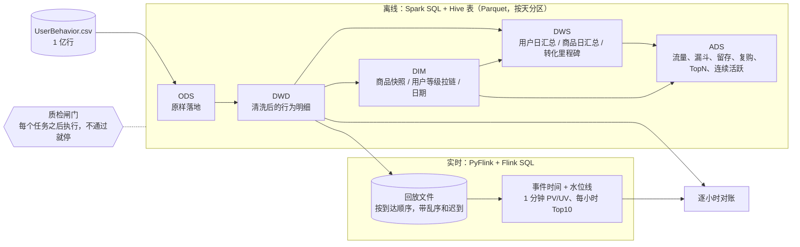
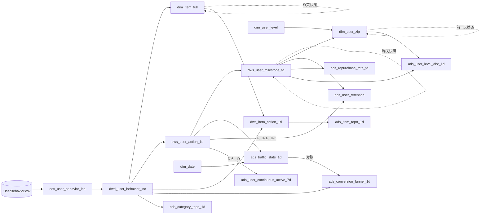

# 电商用户行为数仓

基于阿里天池公开的淘宝用户行为数据（UserBehavior，约 1 亿条），用 **PySpark + Spark SQL + Hive 表（Parquet）** 搭建的离线数仓：ODS → DWD → DIM → DWS → ADS 五层，包含维度建模（事务 / 周期快照 / 累积快照事实表、拉链表）、质检闸门、按天调度（支持回填、重跑不重复），以及数据倾斜的排查与方案对比；另外用 **PyFlink + Flink SQL** 做了一条按事件时间回放的实时链路，与离线结果逐小时对账。

ETL 全部用 SQL 写（`sql/` 目录），Python 只负责调度、质检和实验。

## 结果速览（全量真实运行）

| 项 | 数字 |
|---|---|
| 源数据 | 100,150,807 行；987,994 个用户、4,162,024 个商品、9,439 个类目 |
| 清洗 | 越界时间戳 55,576 行（分布在 338 个日期上）、完全重复 49 行；DWD 留下 100,095,182 行，逐层行数守恒 |
| 全量跑完 | 3 个初始化任务 + 14 个按天任务 × 9 天 = 129 次任务，共 914 秒（M1 Pro 笔记本，Spark `local[8]`、driver 6 GB） |
| 质检闸门 | 448 次检查：447 次 error 级全部通过；1 次 warn 是已知的越界数据，只记录不阻断 |
| 测试 | 22 个 pytest 用例，手工构造小数据覆盖留存、两种漏斗口径、连续活跃、复购、拉链表回滚重跑等边界情况 |
| 转化漏斗 | 有序（严格）和无序（非严格）两种口径并列：非严格第 3 步是严格的 1.52 ~ 1.60 倍，分别覆盖当天购买用户的 52.3% ~ 55.9% 和 33.6% ~ 36.8% |
| 数据倾斜 | 热门类目关联（关掉广播的大表关联场景）：最重 task 读入行数是中位数的 25 倍；AQE 调低倾斜阈值后最长 task 2.3 s → 0.32 s；广播小表 8.95 s → 1.44 s |
| 实时对账 | Flink SQL 按事件时间回放 1 亿条：水位线 10 s 时实时少 45,166 条，全部是注入的迟到数据；放宽到 5 分钟后 216 个小时全部一致 |
| 踩坑与排查 | 开发中真实碰到的 10 个问题，每个都按"现象 → 怎么发现 → 根因 → 怎么解决 → 数字"记录，见 [踩坑与排查](#踩坑与排查) |

详细数字见 [reports/run_report_full.md](reports/run_report_full.md)（各表行数、各任务耗时、质检明细、全部 ADS 结果）。

## 架构



- 运行环境：PySpark 4.2 本地模式（`local[8]`），Hive 元数据库用 Spark 自带的 Derby，`spark.sql.session.timeZone = Asia/Shanghai`，所有日期和小时都按北京时间算。
- 调度：Python 编排（`warehouse/run.py`），任务声明自己读哪些表的哪些分区，调度器据此排序、检查上游、按天执行。生产环境可以把同样的依赖声明映射到 DolphinScheduler / Airflow 的 DAG。
- 实时数据源：这里用文件按到达顺序回放；生产环境中数据源换成 Kafka，Flink SQL 只需要改建表语句的 `connector`。

## 数据

[天池数据集 649：淘宝用户购物行为数据](https://tianchi.aliyun.com/dataset/649)，无表头 CSV，列为 `user_id, item_id, category_id, behavior_type, timestamp`。
官方说明的时间范围是北京时间 2017-11-25 ~ 2017-12-03。行为类型有 pv（浏览）、fav（收藏）、cart（加购）、buy（购买）四种。

探查结论（[reports/raw_profile_full.md](reports/raw_profile_full.md)）：

- 时间戳最早到 1902 年、最晚到 2037 年，窗口外共 55,576 行，其中 40,231 行在 11-24；窗口内完全重复的只有 49 行。
- 1,405 个商品出现过多个类目（最多 4 个），所以商品维表要定一个取值规则。
- **商品粒度基本不倾斜**：最热商品 812879 只有 32,618 行（0.033%）。**类目粒度明显倾斜**：最大类目 4756105 有 486 万行（4.86%），而类目行数的中位数只有 303 行。倾斜实验因此按类目来做。

## 分层与表

| 层 | 表 | 说明 | 粒度 | 分区与写入方式 |
|---|---|---|---|---|
| ODS | `ods_user_behavior_inc` | CSV 原样落地，不去重不过滤 | 一条原始日志 | `dt` = 行为日期（北京时间），越界时间戳也按真实日期进分区；源文件只有一个，所以一次性动态分区写入 |
| DWD | `dwd_user_behavior_inc` | 行为明细（**事务事实表**）：剔除非法与越界记录、去重、时间戳转北京时间 | 一次行为 | `dt`，每天 `INSERT OVERWRITE` 当天分区 |
| DIM | `dim_date` | 日期维表（星期、是否周末等） | 一天 | 静态 |
| DIM | `dim_user_level` | 用户等级码表：累计购买 0 / 1 / 2~4 / >=5 次对应 L0~L3 | 一个等级 | 静态 |
| DIM | `dim_item_full` | 商品维表，同一商品多个类目时取最近一次行为里的类目 | 商品 | `dt` = 快照日期，每日全量快照（昨天快照 + 今天新商品） |
| DIM | `dim_user_zip` | 用户等级**拉链表**，可回溯任意一天的等级 | 用户 × 等级区间 | `dt` = end_date，当前有效记录在 `9999-12-31` 分区 |
| DWS | `dws_user_action_1d` | 用户日汇总（**周期快照事实表**）：各行为次数、浏览/购买商品数、首末行为时间 | 用户 × 天 | `dt` |
| DWS | `dws_item_action_1d` | 商品日汇总（周期快照事实表）：各行为次数、浏览/购买用户数 | 商品 × 天 | `dt` |
| DWS | `dws_user_milestone_td` | 用户转化里程碑（**累积快照事实表**）：首次浏览/收藏/加购/购买时间、累计购买次数和天数 | 用户 | `dt` = 快照日期，每天一份截至当天的全量 |
| ADS | `ads_traffic_stats_1d` | 日 PV、UV、活跃用户、购买用户、人均浏览 | 天 | `dt` |
| ADS | `ads_conversion_funnel_1d` | 当日转化漏斗：浏览 → 加购/收藏 → 购买，有序（严格）和无序（非严格）两种口径 | 天 × 口径 | `dt` |
| ADS | `ads_user_retention` | 新增 / 活跃用户的次日、第 3 日留存 | 同期群 × 类型 × N | `dt` = 计算日 |
| ADS | `ads_repurchase_rate_td` | 截至当天的复购率（按天、按次数两种口径） | 天 | `dt` |
| ADS | `ads_item_topn_1d` | 当日浏览量 Top10 商品 | 天 × 名次 | `dt` |
| ADS | `ads_category_topn_1d` | 当日购买次数 Top10 类目 | 天 × 名次 | `dt` |
| ADS | `ads_user_continuous_active_7d` | 近 7 日内连续 3 天活跃的用户数 | 天 | `dt` |
| ADS | `ads_user_level_dist_1d` | 当天的用户等级分布（从拉链表回溯） | 天 × 等级 | `dt` |
| 质检 | `dq_check_result` | 每次质检的结果 | 检查项 | `(dt, task)`，重跑覆盖 |

建表语句见 [sql/ddl/create_tables.sql](sql/ddl/create_tables.sql)，每个字段都有中文注释。

## 指标字典

完整定义（含过滤条件、来源表、口径提醒）见 [docs/metrics.md](docs/metrics.md)，这里列主要几个：

| 指标 | 定义 | 粒度 | 来源表 |
|---|---|---|---|
| PV | 当天浏览行为次数 | 天 | dws_user_action_1d |
| UV | 当天有浏览行为的去重用户数 | 天 | dws_user_action_1d |
| 有序（严格）漏斗 | 当天首次浏览之后有加购/收藏、再之后有购买的用户数（同一秒算先后成立） | 天 | dwd_user_behavior_inc |
| 无序（非严格）漏斗 | 当天浏览过、也加购/收藏过、也购买过的用户数，不看先后 | 天 | dwd_user_behavior_inc |
| 第 N 日留存率 | 同期群在 cohort_date + N 当天仍活跃的人数 / 同期群人数，N = 1、3 | 同期群 × N | dws_user_action_1d、dws_user_milestone_td |
| 复购率（按天） | 截至当天购买天数 >= 2 的用户 / 有购买的用户 | 天 | dws_user_milestone_td |
| 连续 3 天活跃 | 近 7 日窗口内存在连续 >= 3 天活跃的用户数（日期减行号分组） | 天 | dws_user_action_1d |
| 商品 / 类目 TopN | 按浏览次数 / 购买次数降序取前 10，同值按 ID 升序 | 天 × 名次 | dws_item_action_1d、dwd_user_behavior_inc |

## 表级血缘

实线是当天分区的依赖，虚线是对自己昨天分区（或前一天状态）的依赖。



血缘和调度用的是同一份声明：[warehouse/tasks.py](warehouse/tasks.py) 里每个任务写明 `reads=((表, 日期偏移), ...)`。

## 质检闸门

每个任务跑完立即执行它的检查规则，结果写入 `dq_check_result`；**任一 error 级规则不通过，打印原因并以退出码 2 结束，后面的任务和日期都不再执行**。规则见 [warehouse/checks.py](warehouse/checks.py)，每条规则是一段返回"违规数"的 SQL，0 为通过。

| 类型 | 例子 |
|---|---|
| 层间行数守恒 | ODS 当天行数 = DWD 行数 + 非法行 + 重复行；DWS 四类行为次数之和 = DWD 行数；累积快照今天的累计购买 = 昨天的累计 + 今天的发生额；商品快照今天的商品数 = 昨天 + 今天新出现的 |
| 主键唯一 | DWD 五列组合唯一；DWS 用户/商品每天一行；拉链表每个用户最多一条当前有效记录 |
| 枚举合法 | 行为类型只能是 pv/fav/cart/buy；拉链表等级必须在码表里；等级码表的区间不重叠、不遗漏 |
| 时间范围 | DWD 每条记录都落在当天 [00:00, 24:00) 北京时间内；ODS 窗口内 9 天都有数据 |
| 一致性 | 漏斗第 1 步（走 DWD 明细算）= 流量表 UV（走 DWS 汇总算）；严格漏斗每一步都不多于非严格漏斗；从拉链表回溯出的当天和前一天等级 = 由累积快照算出的等级 |

全量运行中 error 级检查 447 次全部通过。唯一的 warn 是 ODS 越界数据（55,576 行、338 个分区），属于已知问题，DWD 只读窗口内分区。

## 调度：按天执行、回填、重跑

```bash
.venv/bin/python -m warehouse.run --env full init                                   # 建库建表、静态维表、ODS 落地
.venv/bin/python -m warehouse.run --env full daily --start 2017-11-25 --end 2017-12-03
.venv/bin/python -m warehouse.run --env full daily --start 2017-11-30 --end 2017-12-03   # 回填某几天
.venv/bin/python -m warehouse.run --env full daily --start 2017-12-03 --tasks ads_item_topn_1d  # 只重跑一个任务
```

- **按依赖顺序**：同一天内按 `reads` 里偏移为 0 的依赖做拓扑排序；多天按日期顺序执行。
- **上游检查**：执行前确认每个上游分区存在（拉链表看它的处理水位 `etl.processed_through`），缺了直接报错，不会带着空数据往下算。
- **重跑不重复**：所有按天任务都是 `INSERT OVERWRITE ... PARTITION (dt = '...')`，重跑覆盖当天分区；质检结果也按 `(dt, task)` 覆盖。
- **自依赖任务**（商品快照、累积快照、拉链表）依赖自己前一天的结果，回填某天后要把之后的日期接着重跑。这三张表读昨天、写今天是同一张表，Spark 不允许 `INSERT OVERWRITE` 读写同一张表，所以先写中间表再覆盖目标分区。

## 拉链表

用户等级随累计购买次数升级，用拉链表记录每一段等级的生效区间 `[start_date, end_date]`。

- **分区设计**：按 `end_date` 分区，当前有效记录都在 `9999-12-31` 分区。每天正常处理时只读这一个分区；查某天的状态时，`dt >= 那一天` 就能裁掉更早关闭的分区。
- **每日更新**（[sql/dim/dim_user_zip_stage.sql](sql/dim/dim_user_zip_stage.sql)）：开链记录 FULL JOIN 当天等级 → 等级没变的保持开链；变了的旧记录在 D-1 关闭、新记录从 D 开始 → 先落中间表 → 删除 `dt >= D-1` 的旧分区 → 中间表按 `end_date` 动态分区写回。
- **重跑安全**：每次都先把表"回滚"到 D-1 收盘的状态：`end_date >= D-1` 的记录重新视为开链，`start_date >= D` 的记录丢弃，然后再合并当天变化。所以重跑某一天、再顺序重跑之后的日期，结果和第一次完全一致（[tests/test_zipper.py](tests/test_zipper.py) 里验证）。
- **回溯任意一天**：`SELECT * FROM dim_user_zip WHERE dt >= 'D' AND start_date <= 'D'`；质检里每天都核对"回溯出的当天和前一天等级"与累积快照算出的是否一致。
- **存储对比**：全量 9 天，拉链表 1,837,765 条记录；同样的信息用每日全量快照要存 8,389,695 行，拉链表是它的 21.9%。

## 踩坑与排查

开发过程中真实碰到的问题，每个都按"现象 → 怎么发现 → 根因 → 怎么解决 → 数字"记录。

### 1. 时间戳越界：最早 1902 年、最晚 2037 年

- **现象**：官方说明的数据范围是北京时间 2017-11-25 ~ 12-03，时间戳却最早到 1902 年、最晚到 2037 年。
- **怎么发现**：入库前做全量探查，扫描 1 亿行求时间戳的最小值和最大值，统计窗口外的条数和日期分布（[reports/raw_profile_full.md](reports/raw_profile_full.md)）。
- **根因**：源数据本身带有窗口外的异常时间戳，无法从数据里还原真实时间。
- **怎么解决**：ODS 原样保留，按真实日期落进各自的分区，方便追溯；DWD 只读窗口内的分区，并再按当天北京时间 [00:00, 24:00) 过滤一次；质检用 warn 级记录越界条数，不阻断。
- **数字**：越界 55,576 行，分布在 338 个日期上，其中 40,231 行在 11-24；另有完全重复 49 行。ODS 100,150,807 = DWD 100,095,182 + 越界 55,576 + 重复 49，差值为 0。

### 2. 一个商品挂了多个类目，维表的类目怎么定

- **现象**：同一个商品 ID 在不同记录里对应不同的类目 ID。
- **怎么发现**：探查时按商品统计不同类目的个数。
- **根因**：源数据里商品和类目不是严格一对一。
- **怎么解决**：DWD 保留每条记录原始的类目，代表行为发生时的类目；商品维表每个商品只保留一个类目，取最近一次行为里的类目，同一秒有多个时取类目 ID 大的，保证结果确定（相当于缓慢变化维的 1 型：直接覆盖）。商品日汇总用维表的类目，类目 Top10 用 DWD 原值，指标字典里写明。
- **数字**：4,161,138 个商品中 1,405 个出现过多个类目，单个商品最多 4 个。

### 3. Spark 不允许 INSERT OVERWRITE 读写同一张表

- **现象**：第一次跑样本，商品快照任务在第一天就失败：`[UNSUPPORTED_OVERWRITE.TABLE] Can't overwrite the target that is also being read from`。
- **怎么发现**：调度器打印的任务失败信息。
- **根因**：这类表"今天 = 昨天 + 今天的增量"，读的是昨天的分区、写的是今天的分区，但 Spark 按整张表的路径判断"边读边写"，直接拒绝。Hive 会先写临时目录再替换，所以允许。
- **怎么解决**：先把结果写进中间表，再从中间表覆盖目标分区。商品快照、累积快照、拉链表这三张依赖自己昨天结果的表都这样处理。
- **数字**：3 张表各配 1 张中间表；改完后样本和全量的 129 个任务全部跑通。

### 4. AQE 的倾斜拆分完全没生效

- **现象**：做倾斜的方案对比时，开了 AQE、也调低了倾斜阈值，关联阶段的 task 分布却和关掉 AQE 时一模一样：200 个 task，热点 task 读入 6,490,844 行。
- **怎么发现**：三种配置的分布完全相同，不正常；打印物理执行计划，发现类目表那一侧是内存表扫描（InMemoryTableScan），没有 shuffle（Exchange）。
- **根因**：类目表是缓存（cache）下来的聚合结果，自带"已按 category_id 分成 200 个区"的属性，SortMergeJoin 只对大表做了 shuffle；AQE 的倾斜拆分和分区合并都要求两边都是 shuffle 阶段，于是整个跳过。
- **怎么解决**：把类目表落成真正的 Parquet 表，两边都走 shuffle。
- **数字**：修好后，AQE 默认配置把 200 个分区合并成了 35 个，倾斜拆分也能生效（见下一条）。

### 5. AQE 默认阈值不触发倾斜拆分

- **现象**：上一条修好后，AQE 默认配置下热点分区还是没被拆开，热点 task 仍读入 6,490,884 行，最长 task 反而到了 3.3 秒（小分区合并后，每个 task 变大了）。
- **怎么发现**：看 task 读入行数和 AQE 的最终执行计划，计划里没有 `skew=true`。
- **根因**：AQE 判定倾斜要同时满足"大于中位数的 5 倍"和"大于 256MB"（`skewedPartitionThresholdInBytes` 的默认值），本地的热点分区按行数占比估算只有约 117MB。
- **怎么解决**：按数据量把倾斜阈值调到 16MB，建议分区大小也调到 16MB。
- **数字**：最终执行计划出现 `skew=true`；最长 task 2.29 秒 → 0.32 秒；task 读入行数的最大 / 中位从 25 倍降到 1.8 倍。

### 6. Flink 状态超过 5MB，checkpoint 失败，作业反复重启

- **现象**：第一次全量回放，跑了约 6 分钟就不再产出新结果，进度停在事件时间 11-26 14:24，Flink 进程的 CPU 只有 0.2%。
- **怎么发现**：查 Flink 日志，反复出现 `Size of the state is larger than the maximum permitted memory-backed state. Size=17798684, maxSize=5242880`，接着是 `Exceeded checkpoint tolerable failure threshold`，作业进入 RESTARTING，按指数退避等待重启。
- **根因**：本地模式默认把 checkpoint 存在 JobManager 内存里，上限 5MB；而窗口状态（每分钟的去重用户集合、每小时各商品的计数）约 17.8MB。
- **怎么解决**：checkpoint 改存本地文件系统，间隔 30 秒；重启策略改成最多重试 2 次，出错直接失败，避免悄悄无限重启。
- **数字**：状态 17,798,684 字节，上限 5,242,880 字节；修好后两次全量回放分别用时 259.8 秒和 264.7 秒，输出完整（12,960 个分钟窗口、216 个小时）。

### 7. 对漏斗的猜测被数据推翻

- **现象**：有序漏斗里，当天购买的用户只有约三分之一走完"浏览 → 加购/收藏 → 购买"（11-25：48,021 / 132,622 = 36.2%）。
- **怎么发现**：把漏斗第 3 步和流量表的购买用户数放在一起对比。
- **根因**：最初的猜测是剩下的人前几天就加购过。查 12-03 全部 257,754 笔购买：71.5% 之前从没对这件商品加购或收藏过，前几天加购 / 收藏过的只有 20.1%，当天先加购 / 收藏再买的 8.4%。猜测不成立：加购 / 收藏不是购买的必经步骤。
- **怎么解决**：在有序（严格）漏斗之外补了无序（非严格）漏斗口径，两种并列，指标字典写清区别；同时写明两种口径都覆盖不了"看了直接买"的路径。
- **数字**：非严格漏斗第 3 步是严格的 1.52 ~ 1.60 倍；两种口径分别覆盖当天购买用户的 52.3% ~ 55.9% 和 33.6% ~ 36.8%。

### 8. 留存接近 98%，不正常

- **现象**：以 12-02、12-03 为观察日的留存接近 98%，而前几天是 78% 左右。
- **怎么发现**：留存结果出来后，对比每天活跃用户占全部用户的比例。
- **根因**：12-02、12-03 两天各有约 98% 的用户活跃，前 7 天每天只有 71.5% ~ 74.9%。这是数据集本身用户构成的特点，不代表真实留存。
- **怎么解决**：在指标字典和本文里标注这条口径提醒，不把这两天的留存当成真实留存来解读。
- **数字**：12-02 活跃 970,401 人（98.2%），12-03 活跃 966,977 人（97.9%），全部用户 987,991 人。

### 9. Spark 的 Python 进程用错了解释器

- **现象**：第一次跑样本，写质检结果时报错：`TypeError: unsupported operand type(s) for |: 'type' and 'type'`。
- **怎么发现**：报错堆栈里的路径是系统自带的 Python 3.9，而项目的虚拟环境是 Python 3.12。
- **根因**：Spark 启动 Python 工作进程时默认用系统里的 python3，PySpark 4 的代码用到了 3.9 不支持的写法。
- **怎么解决**：创建 SparkSession 之前，把 `PYSPARK_PYTHON` 设成当前的解释器。
- **数字**：改一行配置，之后没有再出现。

### 10. PyFlink 的依赖装不上

- **现象**：`pip install apache-flink==2.3.0` 失败：依赖的 apache-beam 要从源码编译，报 `No module named 'pkg_resources'`。
- **怎么发现**：逐个检查 PyFlink 2.3 要求的 apache-beam 版本（2.54 ~ 2.61）有没有 Python 3.12 + macOS arm64 的安装包，结果一个都没有。
- **根因**：Beam 只在执行 Python UDF 时才用到；只写 Flink SQL 的作业全部在 JVM 里执行，用不到它。
- **怎么解决**：不带依赖安装 PyFlink，再单独装其余依赖（清单见 [realtime/requirements-flink.txt](realtime/requirements-flink.txt)），并设置 `_python_worker_execution_mode=process`，不启动依赖 Beam 的 Python worker 服务。
- **数字**：检查了 8 个版本，没有一个有对应的安装包；改完后 Flink SQL 作业正常跑完 1 亿条。

## 数据倾斜：现象、排查与方案对比

**现象**：在全量明细（1 亿行）上按类目关联类目维表（9,437 行），并关掉自动广播，模拟"两张表都只能 shuffle"的大表关联。Spark UI 里，关联阶段 200 个 task 中最重的读入 6,490,884 行，是中位数 259,311 行的 **25 倍**；最长 task 2.29 秒，中位数只有 0.07 秒。主流程里没有出现这个问题，原因见本节最后。

**排查**：

1. 看 task 读入行数的分布，确认是少数 task 特别重，而不是整体都慢。
2. 按 key 统计行数找热点：商品粒度不倾斜，最热商品 812879 只占 0.033%；类目粒度明显倾斜，最大类目 4756105 有 486 万行，占 4.86%，而类目行数的中位数只有 303 行。热点来自热门类目。
3. 尝试 AQE 时又碰到两个问题：缓存的小表让 AQE 完全不生效，默认阈值不触发拆分，见上一节"踩坑与排查"第 4、5 条。

**方案对比**：每个配置跑 3 次取中位数；task 时长和每个 task 读入的行数从 Spark UI 的 REST API 读取，执行计划取 AQE 的最终计划。脚本 [skew/skew_experiment.py](skew/skew_experiment.py)，完整结果 [reports/skew_experiment.md](reports/skew_experiment.md)。

| 配置 | 总耗时 | 关联阶段 task 数 | 最长 / 中位 task | task 读入行数 最大 / 中位 |
|---|---|---|---|---|
| SortMergeJoin，AQE 关 | 8.95 s | 200 | 2.29 s / 0.07 s | 6,490,884 / 259,311（25 倍） |
| SortMergeJoin，AQE 开（默认阈值） | 10.84 s | 35 | 3.30 s / 1.13 s | 6,490,884 / 2,943,061 |
| SortMergeJoin，AQE 开（倾斜阈值调到 16MB） | 9.14 s | 145 | 0.32 s / 0.17 s | 1,330,124 / 732,684（1.8 倍） |
| 手工加盐（大表打散到 16 个桶，小表复制 16 份） | 12.57 s | 200 | 0.52 s / 0.22 s | 1,243,775 / 486,061（2.6 倍） |
| 广播小表 | 1.44 s | — | — | 无 shuffle |

**结论**：

- **一边是小表**：直接广播，没有 shuffle，比 SortMergeJoin 快约 6 倍。
- **两边都大、没法广播**：优先用 AQE 倾斜拆分，不用改 SQL，但阈值要按数据量调。默认的 256MB 在本地数据量上不触发，调到 16MB 后最长 task 从 2.3 秒降到 0.32 秒。
- **手工加盐作为兜底**：分布拉平了，但要多算一列盐、小表膨胀 16 倍，shuffle 数据从 1,812MB 涨到 2,372MB，总耗时反而多了 40%。

**如实说明**：

- **拉平之后总耗时几乎没变**：本机只有 8 个并发，热点只占全部数据的 4.86%（小于 1/8）。关联阶段全部 task 的 CPU 时间是 26.3 秒，8 个核平均分下来约 3.3 秒，比最长的那个 task（2.3 秒）还长，所以热点 task 不是瓶颈。按这个比例推算，并发数超过约 20（1 / 4.86%）时，热点 task 才会拖慢整个阶段，那时拆分的收益才会体现在总耗时上。
- **主流程为什么没出现**：主流程按天跑，每次一千万行出头；关联基本按商品或用户，这两个维度不倾斜；很小的表（等级码表 4 行、日期表 365 行）Spark 会自动广播；按类目的统计是聚合，有 map 端预聚合。上面的现象是关掉广播、按类目关联时才出现的。

**聚合会不会倾斜**：按类目统计行为数和去重用户数。

| 配置 | 总耗时（AQE 关） | 总耗时（AQE 开） |
|---|---|---|
| 直接 `GROUP BY category_id` | 11.81 s | 11.31 s |
| 加盐两阶段（先按 类目 + 盐 聚合，再按类目汇总） | 17.09 s | 11.70 s |

这里没有出现倾斜：Spark 会把单个 `count(DISTINCT user_id)` 自动改写成两阶段，先按 (类目, 用户) shuffle 去重（200 个 task 读入行数最大 277,377、中位 274,834，几乎一样），再按类目汇总时每个 map 端已经预聚合过，第二次 shuffle 只传了 93,579 行。所以手工加盐只是多了一轮 shuffle，AQE 关时慢了 45%。
加盐前后结果一致；盐由 `user_id` 派生，保证同一个用户只落进一个桶，否则各桶的去重人数相加会重复计算。

## 实时链路与对账

目的是验证"按事件时间 + 水位线"的实时计算在乱序和迟到数据下的表现，并和离线结果同口径对账。生产环境中数据源换成 Kafka（建表语句的 `connector` 改成 `'kafka'`），其余 SQL 不变。

**回放数据**（[realtime/prepare_replay.py](realtime/prepare_replay.py)）：从 DWD 导出全部 100,095,182 条事件，按"到达时间"排好写成一个文件，和离线用的是同一份清洗后的数据。
- 每条事件随机晚到 0~5 秒（由行内容哈希决定，可复现）：实测正常事件最多比已到达的最大事件时间落后 4 秒；
- 50,270 条事件（0.05%）额外晚 180 秒到达，模拟严重迟到，其中浏览行为 45,168 条。

**Flink SQL 作业**（[realtime/flink_job.py](realtime/flink_job.py)，PyFlink 2.3.0 + JDK 21，本地 mini cluster，并行度 1）：

```sql
CREATE TABLE user_behavior (
    ..., event_ts BIGINT,
    event_time AS TO_TIMESTAMP_LTZ(event_ts * 1000, 3),
    WATERMARK FOR event_time AS event_time - INTERVAL '10' SECOND   -- 有界乱序水位线
) WITH ('connector' = 'filesystem', ...);

-- 1 分钟滚动窗口 PV / UV
SELECT window_start, count(*), count(DISTINCT user_id)
FROM TABLE(TUMBLE(TABLE user_behavior, DESCRIPTOR(event_time), INTERVAL '1' MINUTE))
WHERE behavior_type = 'pv'
GROUP BY window_start, window_end;
-- 每小时 Top10：1 小时窗口聚合后，按 window_start / window_end 分组 ROW_NUMBER（窗口 Top-N，每个窗口只输出一次）
```

文件 sink 在 checkpoint 成功时提交文件，保证 exactly-once。

**对账**（[realtime/reconcile.py](realtime/reconcile.py)）：离线从 DWD 按同样的分钟 / 小时划分、同样的 TopN 并列规则计算，逐分钟、逐小时比较。

| 水位线延迟 | 作业耗时 | 分钟窗口 PV、UV 都一致 | 小时 Top10 一致 | PV 离线 / 实时 | 差异能否解释 |
|---|---|---|---|---|---|
| 10 秒 | 259.8 s | 1,841 / 12,960 | 商品 215 / 216，浏览量 209 / 216 | 89,660,671 / 89,615,505（少 45,166） | 每个分钟的差值都不超过该分钟被推迟的浏览数；实时从不多算 |
| 5 分钟 | 264.7 s | 12,960 / 12,960 | 216 / 216 | 89,660,671 / 89,660,671 | 完全一致 |

- 0~5 秒的乱序都在 10 秒水位线之内，一条没丢；丢掉的 45,166 条都是被推迟 180 秒的浏览事件（注入 45,168 条，另外 2 条落在最后一分钟，到达时窗口还没关）。
- 水位线放宽到 5 分钟（大于最大延迟 184 秒）后，216 个小时全部一致；离线 PV 也等于 ADS 层 9 天 PV 之和。代价是每个窗口要晚 5 分钟才出结果，这就是延迟和完整性之间的取舍。生产中常见做法是水位线定得较紧保证时效，迟到数据另外收集，再用离线结果做 T+1 修正。
- 开发中碰到的两个问题（状态超过 5MB 导致作业反复重启、PyFlink 的依赖装不上）见"踩坑与排查"第 6、10 条。

运行（Flink 的依赖和 PySpark 冲突，单独一个虚拟环境）：

```bash
python3.12 -m venv .venv-flink
.venv-flink/bin/pip install --no-deps apache-flink==2.3.0 apache-flink-libraries==2.3.0
.venv-flink/bin/pip install -r realtime/requirements-flink.txt
.venv/bin/python -m realtime.prepare_replay                     # 生成回放文件（约 1 分钟）
.venv-flink/bin/python realtime/flink_job.py --input data/replay/user_behavior_2017-11-25_2017-12-03.csv \
    --out data/realtime/wm10s --watermark-delay 10              # 约 4.5 分钟
.venv/bin/python -m realtime.reconcile --run-dir data/realtime/wm10s \
    --replay data/replay/user_behavior_2017-11-25_2017-12-03.csv
```

对账报告：[reports/realtime_reconcile_wm10s.md](reports/realtime_reconcile_wm10s.md)、[reports/realtime_reconcile_wm300s.md](reports/realtime_reconcile_wm300s.md)。

## 运行方式

环境：Python 3.12、JDK 17 或 21（Spark 4 不支持更新的 JDK；macOS 上没设 `JAVA_HOME` 时程序会自动找 JDK 21，只影响本进程）。

```bash
python3.12 -m venv .venv && .venv/bin/pip install -r requirements.txt
mkdir -p data/raw data/sample        # 把 UserBehavior.csv 放进 data/raw/
head -n 1000000 data/raw/UserBehavior.csv > data/sample/UserBehavior_1m.csv

.venv/bin/python -m warehouse.run --env sample all     # 100 万行样本，约 2.5 分钟
.venv/bin/python -m warehouse.run --env full all       # 全量 1 亿行，约 15 分钟
.venv/bin/python -m scripts.build_report --env full    # 生成 reports/run_report_full.md
.venv/bin/python -m pytest                             # 22 个用例，约 3 分钟
.venv/bin/python -m skew.skew_experiment               # 倾斜实验
```

实时部分见上一节。环境变量 `TBW_SPARK_MASTER`、`TBW_DRIVER_MEMORY` 可以改并行度和 driver 内存（默认 `local[8]`、`6g`）。

## 目录

```
sql/            全部 ETL：ddl/ 建表，ods/ dwd/ dim/ dws/ ads/ 各层任务
warehouse/      调度（run.py）、任务与依赖声明（tasks.py）、质检规则与闸门（checks.py、quality.py）
tests/          pytest：手工小数据验证各口径和调度行为
skew/           数据倾斜实验
realtime/       回放数据生成、Flink SQL 作业、对账
scripts/        原始数据探查、运行报告
docs/metrics.md 指标字典
reports/        真实运行结果
```

## 设计取舍与已知限制

- **单机**：Spark 本地模式 + 单机 Derby 元数据库，同一时间只能有一个 Spark 进程连元数据库。目的是把分层、建模、调度、质检这些逻辑做完整，换成集群和独立 Hive Metastore 时 SQL 不用改。
- **ODS 一次性落地**：源数据只有一个文件，所以 ODS 用动态分区一次写入全部日期；真实场景中日志按天到达，ODS 也按天加载。越界数据按真实日期保留在 338 个小分区里（保真优先）；数据量大时可以统一放进一个隔离分区，减少小文件和元数据压力。
- **商品快照的代价**：`dim_item_full` 每天存一份全量（9 天共 2,800 万行）。商品类目几乎不变，数据量再大时应改成拉链表。
- **数据集本身的特点**：数据按用户抽样，12-02、12-03 两天的活跃用户各占全部用户的 98% 左右（前 7 天每天 71.5%~74.9%），所以观察日落在这两天的留存接近 98%，不代表真实留存；11-25 是第一天，当天的"新增"就是全部活跃用户。
- **漏斗口径**：两种漏斗都只看当天。第 3 步分别覆盖当天购买用户的 33.6% ~ 36.8%（严格）和 52.3% ~ 55.9%（非严格），剩下的购买用户当天没有同时出现浏览、加购/收藏、购买三类行为（12-03 的购买里 71.5% 之前没加购或收藏过这件商品）。"浏览 → 直接购买"的路径和跨天归因没有单独做。
