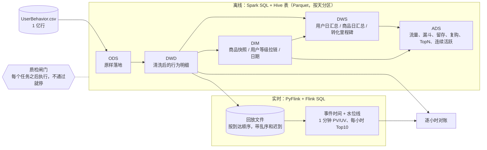
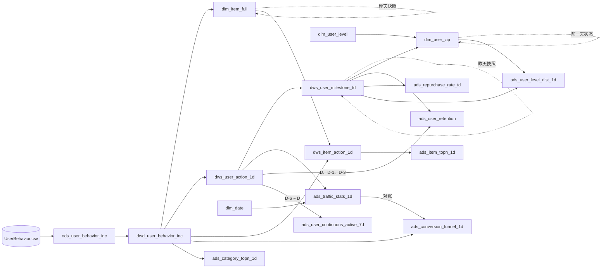

# 电商用户行为数仓

基于阿里天池公开的淘宝用户行为数据（UserBehavior，约 1 亿条），用 **PySpark + Spark SQL + Hive 表（Parquet）** 搭建的离线数仓：ODS → DWD → DIM → DWS → ADS 五层，包含维度建模（事务 / 周期快照 / 累积快照事实表、拉链表）、质检闸门、按天调度（支持回填、重跑不重复）和数据倾斜对比实验；另外用 **PyFlink + Flink SQL** 做了一条按事件时间回放的实时链路，与离线结果逐小时对账。

ETL 全部用 SQL 写（`sql/` 目录），Python 只负责调度、质检和实验。

## 结果速览（全量真实运行）

| 项 | 数字 |
|---|---|
| 源数据 | 100,150,807 行；987,994 个用户、4,162,024 个商品、9,439 个类目 |
| 清洗 | 越界时间戳 55,576 行（分布在 338 个日期上）、完全重复 49 行；DWD 留下 100,095,182 行，逐层行数守恒 |
| 全量跑完 | 3 个初始化任务 + 14 个按天任务 × 9 天 = 129 次任务，共 914 秒（本机 8 线程、driver 6 GB） |
| 质检闸门 | 430 次检查：429 次 error 级全部通过；1 次 warn 是已知的越界数据，只记录不阻断 |
| 测试 | 20 个 pytest 用例，手工构造小数据覆盖留存、漏斗、连续活跃、复购、拉链表回滚重跑等边界情况 |
| 数据倾斜 | <!-- SKEW_SUMMARY --> |
| 实时对账 | <!-- REALTIME_SUMMARY --> |

详细数字见 [reports/run_report_full.md](reports/run_report_full.md)（各表行数、各任务耗时、质检明细、全部 ADS 结果）。

## 架构



- 运行环境：PySpark 4.2 本地模式（`local[8]`），Hive 元数据库用 Spark 自带的 Derby，`spark.sql.session.timeZone = Asia/Shanghai`，所有日期和小时都按北京时间算。
- 调度：Python 编排（`warehouse/run.py`），任务声明自己读哪些表的哪些分区，调度器据此排序、检查上游、按天执行。生产环境可以把同样的依赖声明映射到 DolphinScheduler / Airflow 的 DAG。
- 实时数据源：这里用文件按到达顺序回放；生产环境中数据源换成 Kafka，Flink SQL 只需要改建表语句的 `connector`。

## 数据

[天池数据集 649：淘宝用户购物行为数据](https://tianchi.aliyun.com/dataset/649)，无表头 CSV，列为 `user_id, item_id, category_id, behavior_type, timestamp`。
官方说明的时间范围是北京时间 2017-11-25 ~ 2017-12-03。行为类型有 pv（浏览）、fav（收藏）、cart（加购）、buy（购买）四种。

探查结论（[reports/raw_profile_full.md](reports/raw_profile_full.md)）：

- 时间戳最早到 1902 年、最晚到 2037 年，窗口外共 55,576 行，其中 40,231 行在 11-24；窗口内完全重复的只有 49 行。
- 1,405 个商品出现过多个类目（最多 4 个），所以商品维表要定一个取值规则。
- **商品粒度基本不倾斜**：最热商品 812879 只有 32,618 行（0.033%）。**类目粒度明显倾斜**：最大类目 4756105 有 486 万行（4.86%），而类目行数的中位数只有 303 行。倾斜实验因此按类目来做。

## 分层与表

| 层 | 表 | 说明 | 粒度 | 分区与写入方式 |
|---|---|---|---|---|
| ODS | `ods_user_behavior_inc` | CSV 原样落地，不去重不过滤 | 一条原始日志 | `dt` = 行为日期（北京时间），越界时间戳也按真实日期进分区；源文件只有一个，所以一次性动态分区写入 |
| DWD | `dwd_user_behavior_inc` | 行为明细（**事务事实表**）：剔除非法与越界记录、去重、时间戳转北京时间 | 一次行为 | `dt`，每天 `INSERT OVERWRITE` 当天分区 |
| DIM | `dim_date` | 日期维表（星期、是否周末等） | 一天 | 静态 |
| DIM | `dim_user_level` | 用户等级码表：累计购买 0 / 1 / 2~4 / >=5 次对应 L0~L3 | 一个等级 | 静态 |
| DIM | `dim_item_full` | 商品维表，同一商品多个类目时取最近一次行为里的类目 | 商品 | `dt` = 快照日期，每日全量快照（昨天快照 + 今天新商品） |
| DIM | `dim_user_zip` | 用户等级**拉链表**，可回溯任意一天的等级 | 用户 × 等级区间 | `dt` = end_date，当前有效记录在 `9999-12-31` 分区 |
| DWS | `dws_user_action_1d` | 用户日汇总（**周期快照事实表**）：各行为次数、浏览/购买商品数、首末行为时间 | 用户 × 天 | `dt` |
| DWS | `dws_item_action_1d` | 商品日汇总（周期快照事实表）：各行为次数、浏览/购买用户数 | 商品 × 天 | `dt` |
| DWS | `dws_user_milestone_td` | 用户转化里程碑（**累积快照事实表**）：首次浏览/收藏/加购/购买时间、累计购买次数和天数 | 用户 | `dt` = 快照日期，每天一份截至当天的全量 |
| ADS | `ads_traffic_stats_1d` | 日 PV、UV、活跃用户、购买用户、人均浏览 | 天 | `dt` |
| ADS | `ads_conversion_funnel_1d` | 当日有序漏斗：浏览 → 加购/收藏 → 购买 | 天 | `dt` |
| ADS | `ads_user_retention` | 新增 / 活跃用户的次日、第 3 日留存 | 同期群 × 类型 × N | `dt` = 计算日 |
| ADS | `ads_repurchase_rate_td` | 截至当天的复购率（按天、按次数两种口径） | 天 | `dt` |
| ADS | `ads_item_topn_1d` | 当日浏览量 Top10 商品 | 天 × 名次 | `dt` |
| ADS | `ads_category_topn_1d` | 当日购买次数 Top10 类目 | 天 × 名次 | `dt` |
| ADS | `ads_user_continuous_active_7d` | 近 7 日内连续 3 天活跃的用户数 | 天 | `dt` |
| ADS | `ads_user_level_dist_1d` | 当天的用户等级分布（从拉链表回溯） | 天 × 等级 | `dt` |
| 质检 | `dq_check_result` | 每次质检的结果 | 检查项 | `(dt, task)`，重跑覆盖 |

建表语句见 [sql/ddl/create_tables.sql](sql/ddl/create_tables.sql)，每个字段都有中文注释。

## 指标字典

完整定义（含过滤条件、来源表、口径提醒）见 [docs/metrics.md](docs/metrics.md)，这里列主要几个：

| 指标 | 定义 | 粒度 | 来源表 |
|---|---|---|---|
| PV | 当天浏览行为次数 | 天 | dws_user_action_1d |
| UV | 当天有浏览行为的去重用户数 | 天 | dws_user_action_1d |
| 有序漏斗 | 当天首次浏览之后有加购/收藏、再之后有购买的用户数（同一秒算先后成立） | 天 | dwd_user_behavior_inc |
| 第 N 日留存率 | 同期群在 cohort_date + N 当天仍活跃的人数 / 同期群人数，N = 1、3 | 同期群 × N | dws_user_action_1d、dws_user_milestone_td |
| 复购率（按天） | 截至当天购买天数 >= 2 的用户 / 有购买的用户 | 天 | dws_user_milestone_td |
| 连续 3 天活跃 | 近 7 日窗口内存在连续 >= 3 天活跃的用户数（日期减行号分组） | 天 | dws_user_action_1d |
| 商品 / 类目 TopN | 按浏览次数 / 购买次数降序取前 10，同值按 ID 升序 | 天 × 名次 | dws_item_action_1d、dwd_user_behavior_inc |

## 表级血缘

实线是当天分区的依赖，虚线是对自己昨天分区（或前一天状态）的依赖。



血缘和调度用的是同一份声明：[warehouse/tasks.py](warehouse/tasks.py) 里每个任务写明 `reads=((表, 日期偏移), ...)`。

## 质检闸门

每个任务跑完立即执行它的检查规则，结果写入 `dq_check_result`；**任一 error 级规则不通过，打印原因并以退出码 2 结束，后面的任务和日期都不再执行**。规则见 [warehouse/checks.py](warehouse/checks.py)，每条规则是一段返回"违规数"的 SQL，0 为通过。

| 类型 | 例子 |
|---|---|
| 层间行数守恒 | ODS 当天行数 = DWD 行数 + 非法行 + 重复行；DWS 四类行为次数之和 = DWD 行数；累积快照今天的累计购买 = 昨天的累计 + 今天的发生额；商品快照今天的商品数 = 昨天 + 今天新出现的 |
| 主键唯一 | DWD 五列组合唯一；DWS 用户/商品每天一行；拉链表每个用户最多一条当前有效记录 |
| 枚举合法 | 行为类型只能是 pv/fav/cart/buy；拉链表等级必须在码表里；等级码表的区间不重叠、不遗漏 |
| 时间范围 | DWD 每条记录都落在当天 [00:00, 24:00) 北京时间内；ODS 窗口内 9 天都有数据 |
| 一致性 | 漏斗第 1 步（走 DWD 明细算）= 流量表 UV（走 DWS 汇总算）；从拉链表回溯出的当天和前一天等级 = 由累积快照算出的等级 |

全量运行中 error 级检查 429 次全部通过。唯一的 warn 是 ODS 越界数据（55,576 行、338 个分区），属于已知问题，DWD 只读窗口内分区。

## 调度：按天执行、回填、重跑

```bash
.venv/bin/python -m warehouse.run --env full init                                   # 建库建表、静态维表、ODS 落地
.venv/bin/python -m warehouse.run --env full daily --start 2017-11-25 --end 2017-12-03
.venv/bin/python -m warehouse.run --env full daily --start 2017-11-30 --end 2017-12-03   # 回填某几天
.venv/bin/python -m warehouse.run --env full daily --start 2017-12-03 --tasks ads_item_topn_1d  # 只重跑一个任务
```

- **按依赖顺序**：同一天内按 `reads` 里偏移为 0 的依赖做拓扑排序；多天按日期顺序执行。
- **上游检查**：执行前确认每个上游分区存在（拉链表看它的处理水位 `etl.processed_through`），缺了直接报错，不会带着空数据往下算。
- **重跑不重复**：所有按天任务都是 `INSERT OVERWRITE ... PARTITION (dt = '...')`，重跑覆盖当天分区；质检结果也按 `(dt, task)` 覆盖。
- **自依赖任务**（商品快照、累积快照、拉链表）依赖自己前一天的结果，回填某天后要把之后的日期接着重跑。这三张表读昨天、写今天是同一张表，Spark 不允许 `INSERT OVERWRITE` 读写同一张表，所以先写中间表再覆盖目标分区。

## 拉链表

用户等级随累计购买次数升级，用拉链表记录每一段等级的生效区间 `[start_date, end_date]`。

- **分区设计**：按 `end_date` 分区，当前有效记录都在 `9999-12-31` 分区。每天正常处理时只读这一个分区；查某天的状态时，`dt >= 那一天` 就能裁掉更早关闭的分区。
- **每日更新**（[sql/dim/dim_user_zip_stage.sql](sql/dim/dim_user_zip_stage.sql)）：开链记录 FULL JOIN 当天等级 → 等级没变的保持开链；变了的旧记录在 D-1 关闭、新记录从 D 开始 → 先落中间表 → 删除 `dt >= D-1` 的旧分区 → 中间表按 `end_date` 动态分区写回。
- **重跑安全**：每次都先把表"回滚"到 D-1 收盘的状态：`end_date >= D-1` 的记录重新视为开链，`start_date >= D` 的记录丢弃，然后再合并当天变化。所以重跑某一天、再顺序重跑之后的日期，结果和第一次完全一致（[tests/test_zipper.py](tests/test_zipper.py) 里验证）。
- **回溯任意一天**：`SELECT * FROM dim_user_zip WHERE dt >= 'D' AND start_date <= 'D'`；质检里每天都核对"回溯出的当天和前一天等级"与累积快照算出的是否一致。
- **存储对比**：全量 9 天，拉链表 1,837,765 条记录；同样的信息用每日全量快照要存 8,389,695 行，拉链表是它的 21.9%。

## 数据倾斜实验

<!-- SKEW_SECTION -->

## 实时链路与对账

<!-- REALTIME_SECTION -->

## 运行方式

环境：Python 3.12、JDK 17 或 21（Spark 4 不支持更新的 JDK；macOS 上没设 `JAVA_HOME` 时程序会自动找 JDK 21，只影响本进程）。

```bash
python3.12 -m venv .venv && .venv/bin/pip install -r requirements.txt
mkdir -p data/raw data/sample        # 把 UserBehavior.csv 放进 data/raw/
head -n 1000000 data/raw/UserBehavior.csv > data/sample/UserBehavior_1m.csv

.venv/bin/python -m warehouse.run --env sample all     # 100 万行样本，约 2.5 分钟
.venv/bin/python -m warehouse.run --env full all       # 全量 1 亿行，约 15 分钟
.venv/bin/python -m scripts.build_report --env full    # 生成 reports/run_report_full.md
.venv/bin/python -m pytest                             # 20 个用例，约 3 分钟
.venv/bin/python -m skew.skew_experiment               # 倾斜实验
```

实时部分见上一节。环境变量 `TBW_SPARK_MASTER`、`TBW_DRIVER_MEMORY` 可以改并行度和 driver 内存（默认 `local[8]`、`6g`）。

## 目录

```
sql/            全部 ETL：ddl/ 建表，ods/ dwd/ dim/ dws/ ads/ 各层任务
warehouse/      调度（run.py）、任务与依赖声明（tasks.py）、质检规则与闸门（checks.py、quality.py）
tests/          pytest：手工小数据验证各口径和调度行为
skew/           数据倾斜实验
realtime/       回放数据生成、Flink SQL 作业、对账
scripts/        原始数据探查、运行报告
docs/metrics.md 指标字典
reports/        真实运行结果
```

## 设计取舍与已知限制

- **单机**：Spark 本地模式 + 单机 Derby 元数据库，同一时间只能有一个 Spark 进程连元数据库。目的是把分层、建模、调度、质检这些逻辑做完整，换成集群和独立 Hive Metastore 时 SQL 不用改。
- **ODS 一次性落地**：源数据只有一个文件，所以 ODS 用动态分区一次写入全部日期；真实场景中日志按天到达，ODS 也按天加载。越界数据按真实日期保留在 338 个小分区里（保真优先）；数据量大时可以统一放进一个隔离分区，减少小文件和元数据压力。
- **商品快照的代价**：`dim_item_full` 每天存一份全量（9 天共 2,800 万行）。商品类目几乎不变，数据量再大时应改成拉链表。
- **数据集本身的特点**：数据按用户抽样，12-02、12-03 两天的活跃用户各占全部用户的 98% 左右（前 7 天每天 71.5%~74.9%），所以观察日落在这两天的留存接近 98%，不代表真实留存；11-25 是第一天，当天的"新增"就是全部活跃用户。
- **漏斗口径**：有序漏斗只统计当天内按顺序完成的步骤。当天购买的用户里只有约三分之一在当天走完"浏览 → 加购/收藏 → 购买"，其余多是购买前几天就加购过的商品，这类转化需要跨天归因，当前没有做。
